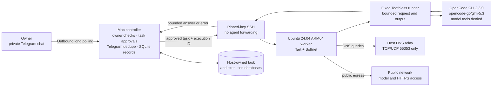

<p align="center"></p>

<h1 align="center">Toothless</h1>

<p align="center">A personal AI agent with a trusted Mac controller and an isolated Ubuntu worker.</p>

<p align="center"><strong>Owner-approved tasks. Protected worker. No unattended execution.</strong></p>

## What Toothless does

Toothless lets its owner create and manage tasks from a private Telegram chat. When the owner explicitly approves a task with `/run`, the Mac controller sends it to OpenCode running inside an isolated Ubuntu virtual machine. OpenCode returns an answer; the controller stores it on the Mac and delivers it to Telegram.

Toothless is designed to keep AI execution out of the Mac host. The controller owns identity checks, approvals, task records, execution records, and VM lifecycle controls. The Ubuntu worker runs the selected model. Model tools are disabled, so OpenCode cannot use shell, file-editing, browser, or MCP tools at this checkpoint.

## Architecture



The controller runs on the Mac and accepts messages only from the configured numeric owner ID in a private Telegram chat. It uses outbound Telegram polling; it does not expose a public webhook or inbound service. The host stores task state and execution history in separate owner-private SQLite databases.

Tart runs Ubuntu through Softnet. The protected launcher applies and verifies a directional block on new guest connections to the Mac, with DNS restricted to the validated host relay. Public IPv4 access remains available for OpenCode inference and HTTPS. SSH is initiated from the Mac using a pinned guest host key and a dedicated Ed25519 identity.

## Implemented features

| Phase | Capability | Status |
|---|---|---|
| 00 | OpenCode CLI adapter, explicit model selection, structured results, timeouts, output limits, and deny-all tools | Verified with real inference |
| 01 | Tart/Softnet Ubuntu worker, protected startup, host isolation, DNS relay, reset, and emergency stop | Verified for the current deployment profile |
| 02 | Typed worker operations, pinned-key SSH, execution IDs, bounded process handling, and host-owned recovery records | Verified with deterministic and live-worker checks |
| 03 | Owner-only Telegram polling, worker/task status, task history, and cancellation controls | Live owner workflow verified; a second-account rejection test was not available |
| 04 | Durable queued tasks, task details, instructions, pause/resume, and restart persistence | Live owner workflow verified |
| 05.1 | Explicit `/run` approval, real OpenCode execution in Ubuntu, result delivery, restart recovery, duplicate-run protection, and bounded cancellation | Verified with the selected model and live Telegram bot |

See [the feature map](docs/features.md), [current status](docs/status.md), and [phase reports](reports/) for evidence and remaining work.

## Telegram commands

Configure the bot and owner ID outside this repository as described in [Telegram setup](docs/telegram-setup.md). Start one controller process for the bot:

```bash
uv run --no-sync python -m nanobot.personal_agent.telegram_controller
```

Common commands:

| Command | Action |
|---|---|
| `/ping` | Check that the controller is polling |
| `/worker` | Read the current worker state without starting or changing the VM |
| `/status` | Show controller, worker, and enabled capability status |
| `/new <request>` | Add a task to the queue; it does not start work |
| Natural-language text | Create a queued task; it does not start work |
| `/tasks` | List recent tasks |
| `/task <task_id>` | Show task state, execution ID, errors, and saved result |
| `/run <task_id>` | Explicitly approve and start one queued task |
| `/cancel <task_id>` | Request cancellation of that task's guest execution |
| `/pause <task_id>` / `/resume <task_id>` | Change an eligible queued task's state |
| `/update <task_id> <instructions>` | Add instructions before execution |
| `/help` | List available commands |

A task remains queued until the owner sends `/run`. Toothless does not automatically run previously queued tasks or start a stopped VM in response to status, task-list, or cancellation requests.

## Run the current worker

The VM and Softnet configuration are specific to the reviewed Apple silicon Mac, dedicated external SSD, installed Tart/Softnet versions, and operator-managed SSH key. Read [the worker operator guide](docs/worker-vm.md) before provisioning another host. Do not launch Tart directly for a protected run.

On the configured host, use the protected launcher:

```bash
ops/worker/start.sh
```

After a worker reset, reinstall the fixed guest execution helper and OpenCode runtime while the worker is running under that launcher:

```bash
ops/worker/install-execution-agent.sh
ops/worker/install-opencode.sh
```

If OpenCode guest authentication is not configured, use the interactive helper from a local Terminal:

```bash
ops/worker/opencode-auth-login.sh
```

The credential is entered and stored inside the Ubuntu guest. Do not copy the Mac's OpenCode auth directory, put credentials in the repository, or send them in Telegram or chat. Guest root can access guest-local provider credentials.

## Security boundaries and known limits

- The worker starts through `ops/worker/start.sh`; direct Tart launches bypass the repository's Softnet policy setup and are unprotected.
- OpenCode uses the fixed model `opencode-go/glm-5.3`. The task runner rejects other models and has no automatic provider or paid-model fallback.
- OpenCode tools, plugins, and MCP are disabled. Telegram text is never executed on the Mac, and the worker interface is not registered as an OpenCode tool.
- SSH host-key verification is strict. The Mac's SSH agent, home directory, Docker socket, clipboard, and host filesystem are not mounted or forwarded to Ubuntu.
- Phase 01 isolation applies to the tested current deployment profile; future network changes and IPv6-enabled routes need separate verification.
- DNS is routed through a validated relay and rate-limited, but DNS names can carry data. Public encrypted DNS services and other public IPv4 destinations remain reachable.
- Guest-local provider credentials are accessible to guest root. OpenCode Go billing entitlements were not audited.
- Unattended scheduling, arbitrary model tools, browser research, connectors, and general autonomous command execution are not enabled. The recent cancellation flow produced duplicate confirmation messages once; the fix is covered by a local regression test but has not been repeated live.

## Development checks

Install the locked development dependencies:

```bash
uv sync --locked --extra dev
```

Run the Toothless controller, worker, and security tests:

```bash
uv run --no-sync pytest tests/personal_agent
```

Run lint, type, import-boundary, and worker static checks:

```bash
uv run --no-sync ruff check nanobot/personal_agent nanobot/worker/ssh_backend.py nanobot/worker/execution_store.py ops/worker/opencode_task_runner.py tests/personal_agent
uv run --no-sync basedpyright nanobot/personal_agent nanobot/worker/ssh_backend.py nanobot/worker/execution_store.py ops/worker/opencode_task_runner.py
uv run --no-sync python -m scripts.check_import_boundaries
ops/worker/test-static.sh
```

Deterministic tests do not replace live verification of Telegram, the provider, SSH identity, or the VM network boundary. Live test prerequisites and results are recorded in the relevant [phase reports](reports/).

## Project documentation

- [Architecture](docs/architecture.md)
- [Feature map and future phases](docs/features.md)
- [Current verification and deployment status](docs/status.md)
- [Telegram setup and operations](docs/telegram-setup.md)
- [Worker VM operator guide](docs/worker-vm.md)
- [Authoritative implementation plan](INSTRUCTIONS.md)
- [Phase reports](reports/)

## Nanobot credit

Toothless builds on the open-source [Nanobot](https://github.com/HKUDS/nanobot) project by HKUDS and its contributors. It reuses selected Python gateway and Telegram foundations; Nanobot's other features are not automatically Toothless capabilities. See [the reuse decision](docs/decisions/0001-adopt-nanobot-v0.4.1.md), [upstream map](docs/upstream-map.md), [LICENSE](LICENSE), and [third-party notices](THIRD_PARTY_NOTICES.md).
