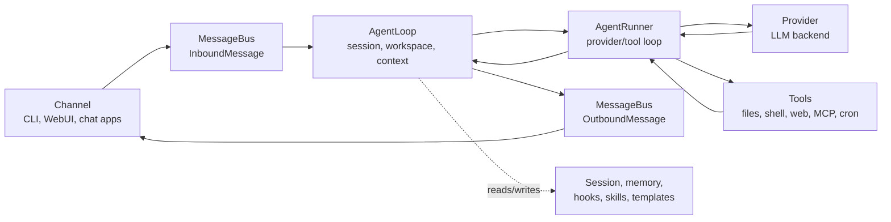

# Architecture

## Personal-agent deployment boundary

This fork uses a deterministic controller on the trusted Mac and deploys OpenCode as the primary autonomous engine inside a dedicated Linux worker VM. Telegram credentials, policy, authoritative task state, budgets, approvals, fixed VM lifecycle operations, and validated artifact copies remain controller-owned. OpenCode's shell, file edits, plugins, browser code, and other model-directed execution stay inside the guest. The controller exposes no general host-shell tool. The VM may administer itself but is not trusted to enforce its own containment, report its own health, or protect provider credentials from guest root. Nanobot remains an optional source of reviewed channel/service components rather than a second autonomous loop.

Task state is owned by `nanobot.personal_agent.task_store.TaskStore` in a host SQLite database with owner-only permissions. A Telegram update ID is stored uniquely on the task row; creation commits before the update advances the polling offset so a replay returns the same task. Task events, instructions, progress/error fields, results, approvals, cancellation intent, and worker execution associations are persisted there. `/tasks`, `/task`, `/update`, `/pause`, `/resume`, and task `/cancel` operate on this database; `/run <task_id>` is the only dispatch authorization. A SQLite transaction records dispatch intent and the worker execution ID before SSH. The task becomes `running` only when the existing pinned-key SSH protocol delivers its explicit acceptance acknowledgement. A transaction also enforces one active task runner. The process never automatically drains queued Phase 04 tasks.

Host-owned lifecycle operations are fixed commands that agent code cannot parameterize into arbitrary host execution. The Phase 01 launcher applies and verifies a Softnet directional policy that blocks new guest-initiated flows to the Mac gateway while allowing only TCP/UDP port 55353 to the host-side DNS relay and stateful return traffic for Mac-initiated SSH. The relay validates DNS payloads and forwards over DNS-over-TLS; DNS-name exfiltration and direct public DoH/DoT remain possible. Owned host, link-local, and metadata-shaped fixtures pass with UFW inactive, and management SSH remains usable. Phase 01 is verified for the documented current IPv4 profile; future IPv6-enabled routes remain unverified. Phase 02.1 defines the typed worker contract and deterministic fake backend. Phase 02.2 adds strict key-only SSH with a guest host key pinned from Tart's trusted guest-agent channel, a fixed root-owned protocol helper that drops to `admin`, JSON request data over stdin, bounded command output, process-group timeout/cancellation, and binary-safe workspace file operations. A guest sends its acceptance line only after the operation is handled; the controller persists that acceptance before awaiting the SSH response. Phase 02.3 commits each intent to a host-owned SQLite database before dispatch, persists status/result/error and cancellation state, and reconciles by the same execution ID after reconnect. Command text and SSH credentials are not stored. Missing guest journal state after reset stays `unknown` with an explicit error; commands are never resubmitted automatically. The helper is restored after reset by `ops/worker/install-execution-agent.sh` following protected startup, rather than by changing the sealed baseline. The SSH backend is not registered in the model tool registry, and no model-generated command has a host execution path. This repository is not an unattended deployment.

## Phase 00 OpenCode boundary

`nanobot.providers.opencode_cli.OpenCodeCLI` is the bounded engine-facing interface; it does not enter Nanobot's `AgentLoop` or `AgentRunner`. Immutable model and size/time policy lives separately in `nanobot.providers.opencode_config.OpenCodeEngineConfig`. The controller admits only `opencode-go/glm-5.3`, constructs `opencode run` arguments without a shell, captures JSON-lines events, records duration/session/event metadata, bounds total output and individual event sizes, and maps quota, model, authentication, network, timeout, cancellation, malformed-output, and process failures to typed results. There is no model/provider retry or fallback path.

The tracked Phase 00 OpenCode configuration at `ops/opencode/phase00/opencode.json` contains only settings confirmed by `opencode debug config --standalone`: the exact model, a five-step primary agent, and deny-all permissions at both top level and agent level. OpenCode v2.3.0 silently omitted the earlier experimental `policy` keys, so they were removed instead of being treated as enforcement. Provider authorization is controller-owned; tool denial is enforced by the recognized OpenCode permission configuration. Host execution is limited to this operator-invoked, tool-denied Phase 00 model probe. Autonomous OpenCode execution remains VM-only in Phase 05.

## Phase 05 guest task execution

Phase 05.1 uses `nanobot.personal_agent.opencode_task.OpenCodeTaskRunner` as a bounded request builder, worker execution monitor, and result parser, not as a second model loop. It passes task text as base64-encoded JSON to a root-owned fixed Python entry point in Ubuntu through the existing `WorkerInterface.execute`. Host dispatch intent and execution ID persist before SSH; a running acceptance is polled under the same ID to terminal, and interruptions are reconciled without resubmission. Each task still needs the owner's `/run <task_id>` approval; queued tasks are not drained automatically.

Phase 05.2 enables OpenCode `read`, `edit` (write/patch), `glob`, `grep`, and `shell` actions only in the guest agent's configured working location. The policy denies all actions first, denies external-directory access, and denies `sudo`, `su`, `doas`, system package-manager commands, service control, reboot/shutdown, and mount operations. The `toothless-agent` Ubuntu system account has only its own primary group, has no SSH key, and is not in the `sudo`, `admin`, `adm`, `docker`, or `root` groups. The host dispatcher invokes only the fixed root-owned runner via noninteractive sudo; that runner validates the fixed model/configuration and drops OpenCode to `toothless-agent`. The private agent home stores its separate guest-local OpenCode login; the existing SSH `admin` identity cannot traverse the credential directories. The writable `/home/toothless-agent/workspace` is exposed to the existing authenticated worker file interface only as `opencode-task-workspace/`.

The guest runner pins OpenCode v2.3.0, `opencode-go/glm-5.3`, empty plugins/MCP, disabled updates, one allowed provider, no subagents, 12 reasoning steps, 120-second inference timeout, 1 MiB total event output, 64 KiB per event, and 48 KB final answer. It captures tool names from structured `tool_use` events without storing tool arguments. It rechecks `opencode debug config --standalone` before every inference and rejects unknown sources or policy changes. The host task/execution stores, Telegram token, SSH private key, and Mac filesystem are not mounted into the guest. The guest system package manager and privilege elevation remain disabled. The Ubuntu image lacks `python3-venv`/pip provisioning, so installing additional Python packages is not yet verified; a one-time guest package bootstrap requires separate operator approval and does not grant the model sudo access.

OpenCode shell commands execute with the `toothless-agent` guest identity and still have that guest user's process and public-network authority. OpenCode permissions and command-pattern denials are application controls; shell scanning is not a process sandbox. A shell child can access the same guest-local OpenCode credential needed by the model and may use public internet egress, so this credential and data remain within the guest trust domain and DNS/public-network exfiltration remains possible. No host credential is available to that account. Phase 05.2 does not enable general paid-provider fallback, browser/MCP/plugin tools, unrestricted root/system package access, Telegram file delivery, or unattended dispatch. The host persists actual answers/errors and sends bounded Telegram results; outgoing text converts common Markdown to Telegram HTML with plain content escaped, while stored task results remain unchanged. Delivery failures remain recorded.

If a worker reset removes the guest helper, restore it with `ops/worker/install-execution-agent.sh` after protected startup, then apply the OpenCode account/config with `ops/worker/install-opencode.sh` and authenticate that guest account with `ops/worker/opencode-auth-login.sh`. These are provisioning steps, not baseline edits. If guest execution history is missing, the host reports unknown and never resubmits automatically. Phase 05.1 live inference/recovery/cancellation is verified. Phase 05.2's scoped rootless tools passed live: owner-approved workspace file/shell work, artifact retrieval, duplicate-run protection, controller restart recovery, and cancellation with one Telegram reply were checked on the real worker and bot. System package installation remains disabled pending a separate guest package bootstrap approval.

## Phase 05.3 browser integration

Browser research tasks selected by the host request classifier use the separate root-owned `/etc/toothless/browser.json` profile and `toothless-browser` agent. That profile denies every action first and allows only the seven `toothless_browser_*` stdio MCP tools. It does not expose OpenCode shell, file editing, host tools, plugins, skills, subagents, or other MCP servers. Non-browser tasks keep the Phase 05.2 workspace profile. Both profiles pin `opencode-go/glm-5.3`, disable updates, and are verified against the effective `opencode debug config --standalone` output before each inference.

The root-owned task runner starts the browser-profile process tree in a transient systemd scope with `MemoryMax=1536M`, `TasksMax=128`, and `CPUQuota=200%`. Its pinned `browser-network-policy.json` applies cgroup socket destination filters to OpenCode, the Playwright stdio helper, Chromium, and their descendants. It denies IPv4 loopback, private, CGNAT, link-local, metadata, reserved, and multicast ranges, and denies all IPv6; only the guest systemd-resolved IPv4 stubs `127.0.0.53` and `127.0.0.54` are excepted for DNS. The process-tree policy checks the actual destination IP, so redirects and changed DNS answers cannot bypass it. Live owned loopback/private/link-local/metadata/ULA/mapped-IPv6 listeners were reachable from the authorized fixture process and timed out from the filtered rootless process; public DNS and HTTPS worked in that same scope. A controlled browser resolver-mapping test to an owned metadata-shaped listener also timed out, while the listener was independently reachable before filtering.

The guest MCP helper uses Playwright 1.65.2 and the reviewed Chromium 159.0.8154.6 ARM64 headless shell. It validates HTTP(S) destinations and every routed request, returns bounded rendered text/title/final URL, permits only GET/HEAD browser requests, restricts clicks to links and standalone non-form `type=button` elements, saves screenshots of at most 2 MiB, and downloads at most 10 MiB using a redirect-validating HTTP client. Browser contexts are fresh per task, accept no downloads through Chromium's unbounded download path, expose no remote-debugging port, and are closed when the MCP process exits. Cancellation and timeout stop the transient scope as well as the task process group.

Browser-profile tasks have a 300-second guest OpenCode runtime bound and a 315-second host dispatch/reconciliation bound. The first owner-approved Python release research task reached the earlier 120-second guest deadline without a result. A second explicitly approved task failed with OpenCode `Transport: ETIMEDOUT` after 135 seconds before any browser tool event, so the external model transport must be diagnosed before another request. Other OpenCode tasks retain the 120-second guest and 150-second host bounds. Failed execution IDs are never resubmitted.

This is private-destination isolation for the browser profile, not general egress isolation. Public IPv4 traffic remains available to the selected model provider and arbitrary public web servers; public HTTP/DNS can still exfiltrate task data. The allowed resolver-stub IP exceptions are not port-level controls, though only the DNS stubs listen there in the current guest and the browser tools reject direct private URLs. DNS-name exfiltration remains possible. The OpenCode Go credential remains readable to the same guest identity. The feature does not enable logins, form submissions, POST/PUT requests, purchases, publishing, or destructive actions; GET endpoints can still have server-side effects, so public research tasks must avoid external actions. No global macOS firewall or Softnet rule was changed. Direct Tart launches remain unprotected; only `ops/worker/start.sh` applies the host isolation policy. Browser install/config changes affect the running VM and are not sealed in a new baseline, so a worker reset may remove them. See [`browser-security.md`](./browser-security.md), [`../reports/phase-05-03a.md`](../reports/phase-05-03a.md), and [`../reports/phase-05-03b.md`](../reports/phase-05-03b.md).

This page maps nanobot's runtime behavior to source files. Use it when you are debugging internals, reviewing a PR, adding a provider/channel/tool, or trying to understand where a user-visible behavior comes from.

For the product-level mental model, read [`concepts.md`](./concepts.md) first.

## Core Flow



Main files:

| Area | Files |
|---|---|
| Message events and queue | `nanobot/bus/events.py`, `nanobot/bus/queue.py` |
| Turn orchestration | `nanobot/agent/loop.py` |
| Provider/tool conversation loop | `nanobot/agent/runner.py` |
| Context construction | `nanobot/agent/context.py` |
| Session storage and compaction | `nanobot/session/manager.py` |
| Long-term memory and Dream | `nanobot/agent/memory.py` |

## Agent Loop vs Agent Runner

`AgentLoop` owns the channel-facing turn:

- receives inbound messages;
- determines the effective session and workspace scope;
- builds context;
- wires hooks, progress, and channel metadata;
- publishes outbound messages.

`AgentRunner` owns the model-facing loop:

- sends messages to the selected provider;
- handles streaming deltas and reasoning blocks;
- executes tool calls;
- feeds tool results back into the model;
- stops when a final answer is produced or runtime limits are hit.

MCP connections are application-owned infrastructure. Composition roots create an `MCPProvider`, share its `ToolRegistry` with `AgentLoop`, await `connect()` before use, and guarantee `aclose()` during shutdown; the loop does not manage that lifecycle. `AgentLoop.from_config()` therefore requires a caller-owned `ToolRegistry`; callers using MCP share it with their application-owned `MCPProvider`.

Keep this split in mind when debugging. If a problem is about channel routing, session keys, workspace selection, or outbound delivery, start in `agent/loop.py`. If it is about provider calls, tool calls, streaming, or iteration limits, start in `agent/runner.py`.

After a terminal tool-iteration limit, the next ordinary turn receives a short runtime-context note to follow the current request and resume unfinished work only when asked. `session/turn_continuation.py` owns this budget-stop context; a queued Goal continuation is not a terminal stop. The note is stored with that input for stable model-history replay but is hidden from display history. Tool calls and results remain intact. New or forked histories do not inherit the pending note. This is model guidance, not a tool-execution ban or a fix for sudo authentication.

## Context Budgets

When file reads make a request exceed the context budget, the runner first summarizes history that the model has already received. If the new file results still do not fit, it replaces only the necessary unread text results with a budget error that asks the model to read a smaller range. It saves that same error for replay; it does not restore the oversized result on the next turn. Source files, accepted history, tool call IDs, and tool schemas stay unchanged. This recovery does not bypass the budget limit or offload `read_file` results to more files.

## Providers

Provider metadata is centralized in `nanobot/providers/registry.py`. Configuration fields live in `nanobot/config/schema.py`.

Provider selection uses:

- explicit `agents.defaults.provider` or preset provider;
- provider registry keywords;
- API key prefixes and API base URL hints;
- local provider fallback when `apiBase` is configured;
- gateway fallback for providers that can route many model families.

Provider implementations live in `nanobot/providers/`. Most hosted providers use the OpenAI-compatible implementation, while Anthropic, Azure OpenAI, AWS Bedrock, OpenAI Codex, and GitHub Copilot have specialized paths.

Responses API paths share `nanobot/providers/openai_responses/backend.py`. The backend constructs protocol input, dispatches SDK or HTTP/SSE requests, owns WebSocket sessions, and advances replay and compaction state. SDK, SSE, and WebSocket events use the same parser in `openai_responses/parsing.py`.

Provider adapters supply authentication, endpoint and model rules, supported request fields, hosted tools, and error mapping. Codex enables WebSocket with its beta header; other adapters retain their existing HTTP transports. Protocol compatibility alone does not enable WebSocket or persistent continuation. OpenAI's `extraBody.store` override controls server storage; automatic response-ID continuation currently uses the active WebSocket connection. Full replay state remains local and scoped to the provider endpoint and model.

Useful docs:

- [`providers.md`](./providers.md) for practical setup;
- [`configuration.md#providers`](./configuration.md#providers) for exact provider reference.

## Channels

Channels translate external platforms into `InboundMessage` events and send `OutboundMessage` events back to the platform.

Main files:

| Area | Files |
|---|---|
| Base channel contract | `nanobot/channels/base.py` |
| Channel packages | `nanobot/channels/<channel>/` |
| Discovery and lifecycle | `nanobot/channels/manager.py` |
| WebSocket/WebUI channel | `nanobot/channels/websocket/` |

Channels are discovered by scanning self-contained packages under `nanobot/channels/`. Add a channel by contributing one package that follows [`channel-package-guide.md`](./channel-package-guide.md).

## WebUI and Gateway

`nanobot gateway` starts:

- enabled chat channels;
- the WebSocket channel when configured;
- workspace-scoped cron service;
- system jobs such as Dream and heartbeat;
- the health endpoint on `gateway.port`.

The packaged WebUI is served by the WebSocket channel, not the health endpoint:

| Surface | Default |
|---|---|
| Health endpoint | `http://127.0.0.1:18790/health` |
| WebUI/WebSocket | `http://127.0.0.1:8765` |

WebUI source lives in `webui/`. The production build is written to `nanobot/web/dist/` and bundled into the wheel.

Useful docs:

- [`webui.md`](./webui.md) for the WebUI user guide;
- [`../webui/README.md`](../webui/README.md) for frontend source development;
- [`websocket.md`](./websocket.md) for protocol details.

## Tools

Tools are discovered from `nanobot/agent/tools/` and plugin entry points.

Important files:

| Tool area | Files |
|---|---|
| Tool base and schema | `nanobot/agent/tools/base.py`, `nanobot/agent/tools/schema.py` |
| Discovery | `nanobot/agent/tools/registry.py` |
| Shell execution | `nanobot/agent/tools/shell.py` |
| Filesystem tools | `nanobot/agent/tools/filesystem.py` |
| Web search/fetch | `nanobot/agent/tools/web.py` |
| MCP tools | `nanobot/agent/tools/mcp.py` |
| Cron | `nanobot/agent/tools/cron.py`, `nanobot/cron/` |
| Image generation | `nanobot/agent/tools/image_generation.py` |
| Runtime self-inspection | `nanobot/agent/tools/self.py` |

Tool behavior is part of the model contract. Keep user-visible tool names, schemas, and error messages stable unless a change is intentional.

Before tool execution, schema-guided casting can decode a nested JSON string when the declared type requires an object or array. Simple container-only unions are supported without selecting a preferred branch. String-accepting unions, malformed JSON, mismatched values, and schemas without an explicit container type stay unchanged. This step does not infer types through references or composition rules. The model-facing schema and original tool-call arguments in history remain unchanged.

## Config and Paths

The config schema lives in `nanobot/config/schema.py`. Loading and saving live in `nanobot/config/loader.py`. Runtime path helpers live in `nanobot/config/paths.py`.

Defaults:

| Path | Default |
|---|---|
| Config | `~/.nanobot/config.json` |
| Workspace | `~/.nanobot/workspace/` |
| Sessions | `<config-dir>/sessions/<workspace-id>/sessions.sqlite3` (default: `~/.nanobot/sessions/...`) |
| Memory | `<workspace>/memory/` |
| Cron store | `<workspace>/cron/jobs.json` |
| WebUI/media/log runtime data | config directory subdirectories such as `webui/`, `media/`, and `logs/` |

The schema accepts both camelCase and snake_case keys, but saves config with camelCase aliases.

### Agent-Owned State vs Effective Project Context

Runtime code distinguishes the configured agent workspace from the effective project workspace carried by a session scope. They are often the same path, but a WebUI chat may select a separate project:

| Concern | Path owner |
|---|---|
| Session namespace, `SOUL.md`, `USER.md`, memory, and custom skills | Configured agent workspace |
| Project `AGENTS.md`, relative tool paths, and shell working directory | Effective project workspace |
| Workspace access mode and project metadata | Session workspace scope |

`ContextBuilder` combines project instructions with agent-owned profile and memory. Filesystem and search tools use the project as their ordinary boundary and receive only capability-specific read access to built-in/agent skills and the exact agent history file. Keep those cross-root capabilities read-only and explicit; do not treat the entire agent workspace as an allowed root.

## Memory and Sessions

Session history is the near-term conversation replay. Memory is the longer-term workspace state.

`nanobot/session/history.py` reads full persisted model history for `search_sessions` and `read_session`, including messages before summary checkpoints. Tool results contain public user and assistant text with indexes into the original session messages. Display facts are stored separately from those messages in the same SQLite database; they never become provider context or session-tool history.

`SessionState` owns both logical histories. `history_entries` stores transport-neutral inputs, completed answer/reasoning segments, activity, historical file diffs, response sources, and completion statistics/outcomes; `history_turns` and `history_heads` provide bounded paging and revision/sidebar projections. WebUI converts these facts into its existing transcript protocol inside an owner-managed read snapshot. Delta frames remain transient. A turn may commit facts as it progresses; this is not a transaction held across a model request or network delivery.

Every append carries the generation admitted before execution, including a distinct display destination under unified-session routing. A missing or replaced session rejects the append instead of creating a new row. Delete/reset cascades through both logical histories; fork copies its canonical and display prefixes in one SQLite transaction. Future in-place history replacement should use that same owner transaction rather than file journals or replay-cache writes.

`nanobot/webui/history.py` resolves legacy `<stem>.jsonl` files and numbered JSONL files inside `<stem>.segments/` directories, then imports them through `SessionState` before recovery or transport admission. Recorded chat identities determine the target session; histories without a recorded identity require an unambiguous existing canonical session. Display-only histories with a recorded identity are imported into the starting workspace namespace. Histories owned by exactly one other namespace are deferred to that namespace; duplicate owners and malformed records fail startup.

`SqliteSessionStore.migrate_history()` commits the imported facts and completion markers in one transaction. Per-session ownership receipts in `storage_meta` survive session deletion, so another namespace cannot restore deleted chats by reimporting the unchanged legacy backups.

| Store | File area |
|---|---|
| SQLite conversation state | `<config-dir>/sessions/<workspace-id>/sessions.sqlite3` |
| Long-term memory | `<workspace>/memory/MEMORY.md` |
| Consolidation source history | `<workspace>/memory/history.jsonl` |
| Bootstrap identity files | `<workspace>/SOUL.md`, `<workspace>/USER.md`, templates under `nanobot/templates/` |

Dream is implemented in `nanobot/agent/memory.py` and scheduled by the runtime when enabled.

## Security Boundaries

Security-sensitive code paths include:

| Boundary | Files |
|---|---|
| Workspace scope | `nanobot/security/workspace_access.py`, `nanobot/security/workspace_policy.py` |
| Shell sandboxing | `nanobot/agent/tools/shell.py` |
| SSRF/network checks | `nanobot/security/network.py`, `nanobot/agent/tools/web.py` |
| PTH guard and CLI startup security | `nanobot/security/` and CLI entrypoints |
| Channel access control | channel config in `nanobot/channels/*.py` |

When changing tools, channels, file access, WebUI workspace behavior, or network fetching, treat security as part of the functional behavior and update docs if the user-facing boundary changes.

## Extension Points

| Extension | How |
|---|---|
| Provider | Add `ProviderSpec` in `providers/registry.py`, add schema field in `config/schema.py`, implement provider only if the generic backend is not enough |
| Channel | Export a `ChannelPlugin` descriptor, keep its runtime and optional setup surfaces in one package, and follow [`channel-package-guide.md`](./channel-package-guide.md) |
| Tool | Implement a tool under `agent/tools/` or expose a plugin entry point |
| Agent Plugin | Add a v1 package under `<workspace>/plugins/` and enable it from Apps |
| MCP | Add `tools.mcpServers` config or bundle the server in an Agent Plugin |
| Skill | Add workspace skills under `<workspace>/skills/`, bundle them in an Agent Plugin, or add built-in skills under `nanobot/skills/` |
| CLI App | Add it to the CLI Apps catalog; the installer owns its executable lifecycle and writes a skills-only Agent Plugin |

Prefer existing registry/discovery patterns over ad hoc wiring.

## Testing and Verification

Common checks:

```bash
pytest tests/test_openai_api.py::test_function -v
ruff check nanobot/
cd webui && bun run test
cd webui && bun run build
```

Choose tests based on the changed surface:

| Change | Minimum useful verification |
|---|---|
| Provider behavior | Provider unit tests or a mocked API path; `nanobot agent -m "Hello!"` with safe config when possible |
| Channel behavior | Channel tests plus `nanobot gateway` startup path |
| WebUI behavior | WebUI tests/build and, for routing/settings/chat changes, browser-level verification through the gateway |
| Tool behavior | Tool unit tests and an agent-run path when schema or model-facing behavior changes |
| Docs | Link checks, command accuracy against CLI/schema, and `git diff --check` |

For user-facing flows, prefer at least one verification path through the public surface the user actually touches: CLI command, HTTP endpoint, WebSocket/WebUI, chat channel, or packaged import.
