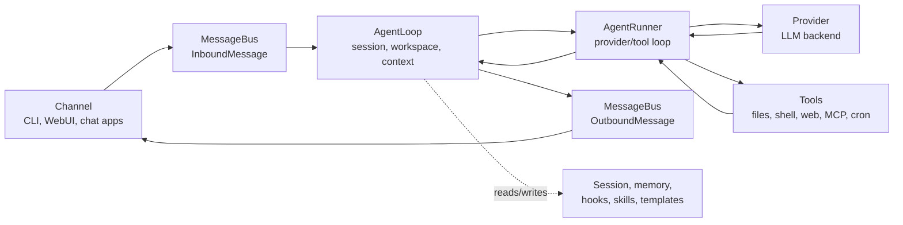

# Architecture

## Personal-agent deployment boundary

This fork uses a deterministic controller on the trusted Mac and deploys OpenCode as the primary autonomous engine inside a dedicated Linux worker VM. Telegram credentials, policy, authoritative task state, budgets, approvals, fixed VM lifecycle operations, and validated artifact copies remain controller-owned. OpenCode's shell, file edits, plugins, browser code, and other model-directed execution stay inside the guest. The controller exposes no general host-shell tool. The VM may administer itself but is not trusted to enforce its own containment, report its own health, or protect provider credentials from guest root. Nanobot remains an optional source of reviewed channel/service components rather than a second autonomous loop.

Task state is owned by `nanobot.personal_agent.task_store.TaskStore` in a host SQLite database with owner-only permissions. A Telegram update ID is stored uniquely on the task row; creation commits before the update advances the polling offset so a replay returns the same task. Task events, instructions, progress/error fields, results, approvals, cancellation intent, and worker execution associations are persisted there. `/tasks`, `/task`, `/update`, `/pause`, `/resume`, and task `/cancel` operate on this database; `/run <task_id>` is the only dispatch authorization. A SQLite transaction records dispatch intent and the worker execution ID before SSH. The task becomes `running` only when the existing pinned-key SSH protocol delivers its explicit acceptance acknowledgement. A transaction also enforces one active task runner. The process never automatically drains queued Phase 04 tasks.

Host-owned lifecycle operations are fixed commands that agent code cannot parameterize into arbitrary host execution. The Phase 01 launcher applies and verifies a Softnet directional policy that blocks new guest-initiated flows to the Mac gateway while allowing only TCP/UDP port 55353 to the host-side DNS relay and stateful return traffic for Mac-initiated SSH. The relay validates DNS payloads and forwards over DNS-over-TLS; DNS-name exfiltration and direct public DoH/DoT remain possible. Owned host, link-local, and metadata-shaped fixtures pass with UFW inactive, and management SSH remains usable. Phase 01 is verified for the documented current IPv4 profile; future IPv6-enabled routes remain unverified. Phase 02.1 defines the typed worker contract and deterministic fake backend. Phase 02.2 adds strict key-only SSH with a guest host key pinned from Tart's trusted guest-agent channel, a fixed root-owned protocol helper that drops to `admin`, JSON request data over stdin, bounded command output, process-group timeout/cancellation, and binary-safe workspace file operations. A guest sends its acceptance line only after the operation is handled; the controller persists that acceptance before awaiting the SSH response. Phase 02.3 commits each intent to a host-owned SQLite database before dispatch, persists status/result/error and cancellation state, and reconciles by the same execution ID after reconnect. Command text and SSH credentials are not stored. Missing guest journal state after reset stays `unknown` with an explicit error; commands are never resubmitted automatically. The helper is restored after reset by `ops/worker/install-execution-agent.sh` following protected startup, rather than by changing the sealed baseline. The SSH backend is not registered in the model tool registry, and no model-generated command has a host execution path. This repository is not an unattended deployment.

## Phase 00 OpenCode boundary

`nanobot.providers.opencode_cli.OpenCodeCLI` is the bounded engine-facing interface; it does not enter Nanobot's `AgentLoop` or `AgentRunner`. Immutable model and size/time policy lives separately in `nanobot.providers.opencode_config.OpenCodeEngineConfig`. The controller admits only `opencode-go/glm-5.3`, constructs `opencode run` arguments without a shell, captures JSON-lines events, records duration/session/event metadata, bounds total output and individual event sizes, and maps quota, model, authentication, network, timeout, cancellation, malformed-output, and process failures to typed results. There is no model/provider retry or fallback path.

The tracked Phase 00 OpenCode configuration at `ops/opencode/phase00/opencode.json` contains only settings confirmed by `opencode debug config --standalone`: the exact model, a five-step primary agent, and deny-all permissions at both top level and agent level. OpenCode v2.3.0 silently omitted the earlier experimental `policy` keys, so they were removed instead of being treated as enforcement. Provider authorization is controller-owned; tool denial is enforced by the recognized OpenCode permission configuration. Host execution is limited to this operator-invoked, tool-denied Phase 00 model probe. Autonomous OpenCode execution remains VM-only in Phase 05.

## Phase 05 guest task execution

Phase 05.1 uses `nanobot.personal_agent.opencode_task.OpenCodeTaskRunner` as a bounded request builder, worker execution monitor, and result parser, not as a second model loop. It passes task text as base64-encoded JSON to a root-owned fixed Python entry point in Ubuntu through the existing `WorkerInterface.execute`. Host dispatch intent and execution ID persist before SSH; a running acceptance is polled under the same ID to terminal, and interruptions are reconciled without resubmission. Each task still needs the owner's `/run <task_id>` approval; queued tasks are not drained automatically.

Phase 05.2 enables OpenCode `read`, `edit` (write/patch), `glob`, `grep`, and `shell` actions only in the guest agent's configured working location. The policy denies all actions first, denies external-directory access, and denies `sudo`, `su`, `doas`, system package-manager commands, service control, reboot/shutdown, and mount operations. The `toothless-agent` Ubuntu system account has only its own primary group, has no SSH key, and is not in the `sudo`, `admin`, `adm`, `docker`, or `root` groups. The host dispatcher invokes only the fixed root-owned runner via noninteractive sudo; that runner validates the fixed model/configuration and drops OpenCode to `toothless-agent`. The private agent home stores its separate guest-local OpenCode login; the existing SSH `admin` identity cannot traverse the credential directories. The writable `/home/toothless-agent/workspace` is exposed to the existing authenticated worker file interface only as `opencode-task-workspace/`.

The guest runner pins OpenCode v2.3.0, `opencode-go/glm-5.3`, empty plugins/MCP, disabled updates, one allowed provider, no subagents, 12 reasoning steps, 120-second inference timeout, 1 MiB total event output, 64 KiB per event, and 48 KB final answer. It captures tool names from structured `tool_use` events without storing tool arguments. It rechecks `opencode debug config --standalone` before every inference and rejects unknown sources or policy changes. The host task/execution stores, Telegram token, SSH private key, and Mac filesystem are not mounted into the guest. The guest system package manager and privilege elevation remain disabled. The Ubuntu image lacks `python3-venv`/pip provisioning, so installing additional Python packages is not yet verified; a one-time guest package bootstrap requires separate operator approval and does not grant the model sudo access.

OpenCode shell commands execute with the `toothless-agent` guest identity and still have that guest user's process and public-network authority. OpenCode permissions and command-pattern denials are application controls; shell scanning is not a process sandbox. A shell child can access the same guest-local OpenCode credential needed by the model and may use public internet egress, so this credential and data remain within the guest trust domain and DNS/public-network exfiltration remains possible. No host credential is available to that account. Phase 05.2 does not enable general paid-provider fallback, browser/MCP/plugin tools, unrestricted root/system package access, Telegram file delivery, or unattended dispatch. The host persists actual answers/errors and sends bounded Telegram results; outgoing text converts common Markdown to Telegram HTML with plain content escaped, while stored task results remain unchanged. Delivery failures remain recorded.

If a worker reset removes the guest helper, restore it with `ops/worker/install-execution-agent.sh` after protected startup, then apply the OpenCode account/config with `ops/worker/install-opencode.sh` and authenticate that guest account with `ops/worker/opencode-auth-login.sh`. These are provisioning steps, not baseline edits. If guest execution history is missing, the host reports unknown and never resubmits automatically. Phase 05.1 live inference/recovery/cancellation is verified. Phase 05.2's scoped rootless tools passed live: owner-approved workspace file/shell work, artifact retrieval, duplicate-run protection, controller restart recovery, and cancellation with one Telegram reply were checked on the real worker and bot. System package installation remains disabled pending a separate guest package bootstrap approval.

## Phase 05.3 browser integration

Browser research tasks selected by the host request classifier use the separate root-owned `/etc/toothless/browser.json` profile and `toothless-browser` agent. That profile denies every action first and allows only the seven `toothless_browser_*` stdio MCP tools. It does not expose OpenCode shell, file editing, host tools, plugins, skills, subagents, or other MCP servers. Non-browser tasks keep the Phase 05.2 workspace profile. Both profiles pin `opencode-go/glm-5.3`, disable updates, and are verified against the effective `opencode debug config --standalone` output before each inference.

The root-owned task runner starts the browser-profile process tree in a transient systemd scope with `MemoryMax=1536M`, `TasksMax=128`, and `CPUQuota=200%`. Its pinned `browser-network-policy.json` applies cgroup socket destination filters to OpenCode, the Playwright stdio helper, Chromium, and their descendants. It denies IPv4 loopback, private, CGNAT, link-local, metadata, reserved, and multicast ranges, and denies all IPv6; only the guest systemd-resolved IPv4 stubs `127.0.0.53` and `127.0.0.54` are excepted for DNS. The process-tree policy checks the actual destination IP, so redirects and changed DNS answers cannot bypass it. Live owned loopback/private/link-local/metadata/ULA/mapped-IPv6 listeners were reachable from the authorized fixture process and timed out from the filtered rootless process; public DNS and HTTPS worked in that same scope. A controlled browser resolver-mapping test to an owned metadata-shaped listener also timed out, while the listener was independently reachable before filtering.

The guest MCP helper uses Playwright 1.65.2 and the reviewed Chromium 159.0.8154.6 ARM64 headless shell. It validates HTTP(S) destinations and every routed request, returns bounded rendered text/title/final URL, permits only GET/HEAD browser requests, restricts clicks to links and standalone non-form `type=button` elements, saves screenshots of at most 2 MiB, and downloads at most 10 MiB using a redirect-validating HTTP client. Browser contexts are fresh per task, accept no downloads through Chromium's unbounded download path, expose no remote-debugging port, and are closed when the MCP process exits. Cancellation and timeout stop the transient scope as well as the task process group.

Browser-profile tasks have a 300-second guest OpenCode runtime bound and a 315-second host dispatch/reconciliation bound. The first owner-approved Python release research task reached the earlier 120-second guest deadline without a result. A second explicitly approved task failed with OpenCode `Transport: ETIMEDOUT` after 135 seconds before any browser tool event, so the external model transport must be diagnosed before another request. Other OpenCode tasks retain the 120-second guest and 150-second host bounds. Failed execution IDs are never resubmitted.

This is private-destination isolation for the browser profile, not general egress isolation. Public IPv4 traffic remains available to the selected model provider and arbitrary public web servers; public HTTP/DNS can still exfiltrate task data. The allowed resolver-stub IP exceptions are not port-level controls, though only the DNS stubs listen there in the current guest and the browser tools reject direct private URLs. DNS-name exfiltration remains possible. The OpenCode Go credential remains readable to the same guest identity. The feature does not enable logins, form submissions, POST/PUT requests, purchases, publishing, or destructive actions; GET endpoints can still have server-side effects, so public research tasks must avoid external actions. No global macOS firewall or Softnet rule was changed. Direct Tart launches remain unprotected; only `ops/worker/start.sh` applies the host isolation policy. Browser install/config changes affect the running VM and are not sealed in a new baseline, so a worker reset may remove them. See [`browser-security.md`](./browser-security.md), [`../reports/phase-05-03a.md`](../reports/phase-05-03a.md), and [`../reports/phase-05-03b.md`](../reports/phase-05-03b.md).

This page maps nanobot's runtime behavior to source files. Use it when you are debugging internals, reviewing a PR, adding a provider/channel/tool, or trying to understand where a user-visible behavior comes from.

For the product-level mental model, read [`concepts.md`](./concepts.md) first.

## Core Flow



Main files:

| Area | Files |
|---|---|
| Message events and queue | `nanobot/bus/events.py`, `nanobot/bus/queue.py` |
| Turn orchestration | `nanobot/agent/loop.py` |
| Provider/tool conversation loop | `nanobot/agent/runner.py` |
| Context construction | `nanobot/agent/context.py` |
| Session storage and compaction | `nanobot/session/manager.py` |
| Long-term memory and Dream | `nanobot/agent/memory.py` |

## Agent Loop vs Agent Runner

`AgentLoop` owns the channel-facing turn:

- receives inbound messages;
- determines the effective session and workspace scope;
- builds context;
- wires hooks, progress, and channel metadata;
- publishes outbound messages.

`AgentRunner` owns the model-facing loop:

- sends messages to the selected provider;
- handles streaming deltas and reasoning blocks;
- executes tool calls;
- feeds tool results back into the model;
- stops when a final answer is produced or runtime limits are hit.

MCP connections are application-owned infrastructure. Composition roots create an `MCPProvider`, share its `ToolRegistry` with `AgentLoop`, await `connect()` before use, and guarantee `aclose()` during shutdown; the loop does not manage that lifecycle. `AgentLoop.from_config()` therefore requires a caller-owned `ToolRegistry`; callers using MCP share it with their application-owned `MCPProvider`.

Keep this split in mind when debugging. If a problem is about channel routing, session keys, workspace selection, or outbound delivery, start in `agent/loop.py`. If it is about provider calls, tool calls, streaming, or iteration limits, start in `agent/runner.py`.

After a terminal tool-iteration limit, the next ordinary turn receives a short runtime-context note to follow the current request and resume unfinished work only when asked. `session/turn_continuation.py` owns this budget-stop context; a queued Goal continuation is not a terminal stop. The note is stored with that input for stable model-history replay but is hidden from display history. Tool calls and results remain intact. New or forked histories do not inherit the pending note. This is model guidance, not a tool-execution ban or a fix for sudo authentication.

## Context Budgets

When file reads make a request exceed the context budget, the runner first summarizes history that the model has already received. If the new file results still do not fit, it replaces only the necessary unread text results with a budget error that asks the model to read a smaller range. It saves that same error for replay; it does not restore the oversized result on the next turn. Source files, accepted history, tool call IDs, and tool schemas stay unchanged. This recovery does not bypass the budget limit or offload `read_file` results to more files.

## Providers

Provider metadata is centralized in `nanobot/providers/registry.py`. Configuration fields live in `nanobot/config/schema.py`.

Provider selection uses:

- explicit `agents.defaults.provider` or preset provider;
- provider registry keywords;
- API key prefixes and API base URL hints;
- local provider fallback when `apiBase` is configured;
- gateway fallback for providers that can route many model families.

Provider implementations live in `nanobot/providers/`. Most hosted providers use the OpenAI-compatible implementation, while Anthropic, Azure OpenAI, AWS Bedrock, OpenAI Codex, and GitHub Copilot have specialized paths.

Responses API paths share `nanobot/providers/openai_responses/backend.py`. The backend constructs protocol input, dispatches SDK or HTTP/SSE requests, owns WebSocket sessions, and advances replay and compaction state. SDK, SSE, and WebSocket events use the same parser in `openai_responses/parsing.py`.

Provider adapters supply authentication, endpoint and model rules, supported request fields, hosted tools, and error mapping. Codex enables WebSocket with its beta header; other adapters retain their existing HTTP transports. Protocol compatibility alone does not enable WebSocket or persistent continuation. OpenAI's `extraBody.store` override controls server storage; automatic response-ID continuation currently uses the active WebSocket connection. Full replay state remains local and scoped to the provider endpoint and model.

Useful docs:

- [`providers.md`](./providers.md) for practical setup;
- [`configuration.md#providers`](./configuration.md#providers) for exact provider reference.

## Channels

Channels translate external platforms into `InboundMessage` events and send `OutboundMessage` events back to the platform.

Main files:

| Area | Files |
|---|---|
| Base channel contract | `nanobot/channels/base.py` |
| Channel packages | `nanobot/channels/<channel>/` |
| Discovery and lifecycle | `nanobot/channels/manager.py` |
| WebSocket/WebUI channel | `nanobot/channels/websocket/` |

Channels are discovered by scanning self-contained packages under `nanobot/channels/`. Add a channel by contributing one package that follows [`channel-package-guide.md`](./channel-package-guide.md).

## WebUI and Gateway

`nanobot gateway` starts:

- enabled chat channels;
- the WebSocket channel when configured;
- workspace-scoped cron service;
- system jobs such as Dream and heartbeat;
- the health endpoint on `gateway.port`.

The packaged WebUI is served by the WebSocket channel, not the health endpoint:

| Surface | Default |
|---|---|
| Health endpoint | `http://127.0.0.1:18790/health` |
| WebUI/WebSocket | `http://127.0.0.1:8765` |

WebUI source lives in `webui/`. The production build is written to `nanobot/web/dist/` and bundled into the wheel.

Useful docs:

- [`webui.md`](./webui.md) for the WebUI user guide;
- [`../webui/README.md`](../webui/README.md) for frontend source development;
- [`websocket.md`](./websocket.md) for protocol details.

## Tools

Tools are discovered from `nanobot/agent/tools/` and plugin entry points.

Important files:

| Tool area | Files |
|---|---|
| Tool base and schema | `nanobot/agent/tools/base.py`, `nanobot/agent/tools/schema.py` |
| Discovery | `nanobot/agent/tools/registry.py` |
| Shell execution | `nanobot/agent/tools/shell.py` |
| Filesystem tools | `nanobot/agent/tools/filesystem.py` |
| Web search/fetch | `nanobot/agent/tools/web.py` |
| MCP tools | `nanobot/agent/tools/mcp.py` |
| Cron | `nanobot/agent/tools/cron.py`, `nanobot/cron/` |
| Image generation | `nanobot/agent/tools/image_generation.py` |
| Runtime self-inspection | `nanobot/agent/tools/self.py` |

Tool behavior is part of the model contract. Keep user-visible tool names, schemas, and error messages stable unless a change is intentional.

Before tool execution, schema-guided casting can decode a nested JSON string when the declared type requires an object or array. Simple container-only unions are supported without selecting a preferred branch. String-accepting unions, malformed JSON, mismatched values, and schemas without an explicit container type stay unchanged. This step does not infer types through references or composition rules. The model-facing schema and original tool-call arguments in history remain unchanged.

## Config and Paths

The config schema lives in `nanobot/config/schema.py`. Loading and saving live in `nanobot/config/loader.py`. Runtime path helpers live in `nanobot/config/paths.py`.

Defaults:

| Path | Default |
|---|---|
| Config | `~/.nanobot/config.json` |
| Workspace | `~/.nanobot/workspace/` |
| Sessions | `<config-dir>/sessions/<workspace-id>/sessions.sqlite3` (default: `~/.nanobot/sessions/...`) |
| Memory | `<workspace>/memory/` |
| Cron store | `<workspace>/cron/jobs.json` |
| WebUI/media/log runtime data | config directory subdirectories such as `webui/`, `media/`, and `logs/` |

The schema accepts both camelCase and snake_case keys, but saves config with camelCase aliases.

### Agent-Owned State vs Effective Project Context

Runtime code distinguishes the configured agent workspace from the effective project workspace carried by a session scope. They are often the same path, but a WebUI chat may select a separate project:

| Concern | Path owner |
|---|---|
| Session namespace, `SOUL.md`, `USER.md`, memory, and custom skills | Configured agent workspace |
| Project `AGENTS.md`, relative tool paths, and shell working directory | Effective project workspace |
| Workspace access mode and project metadata | Session workspace scope |

`ContextBuilder` combines project instructions with agent-owned profile and memory. Filesystem and search tools use the project as their ordinary boundary and receive only capability-specific read access to built-in/agent skills and the exact agent history file. Keep those cross-root capabilities read-only and explicit; do not treat the entire agent workspace as an allowed root.

## Memory and Sessions

Session history is the near-term conversation replay. Memory is the longer-term workspace state.

`nanobot/session/history.py` reads full persisted model history for `search_sessions` and `read_session`, including messages before summary checkpoints. Tool results contain public user and assistant text with indexes into the original session messages. Display facts are stored separately from those messages in the same SQLite database; they never become provider context or session-tool history.

`SessionState` owns both logical histories. `history_entries` stores transport-neutral inputs, completed answer/reasoning segments, activity, historical file diffs, response sources, and completion statistics/outcomes; `history_turns` and `history_heads` provide bounded paging and revision/sidebar projections. WebUI converts these facts into its existing transcript protocol inside an owner-managed read snapshot. Delta frames remain transient. A turn may commit facts as it progresses; this is not a transaction held across a model request or network delivery.

Every append carries the generation admitted before execution, including a distinct display destination under unified-session routing. A missing or replaced session rejects the append instead of creating a new row. Delete/reset cascades through both logical histories; fork copies its canonical and display prefixes in one SQLite transaction. Future in-place history replacement should use that same owner transaction rather than file journals or replay-cache writes.

`nanobot/webui/history.py` resolves legacy `<stem>.jsonl` files and numbered JSONL files inside `<stem>.segments/` directories, then imports them through `SessionState` before recovery or transport admission. Recorded chat identities determine the target session; histories without a recorded identity require an unambiguous existing canonical session. Display-only histories with a recorded identity are imported into the starting workspace namespace. Histories owned by exactly one other namespace are deferred to that namespace; duplicate owners and malformed records fail startup.

`SqliteSessionStore.migrate_history()` commits the imported facts and completion markers in one transaction. Per-session ownership receipts in `storage_meta` survive session deletion, so another namespace cannot restore deleted chats by reimporting the unchanged legacy backups.

| Store | File area |
|---|---|
| SQLite conversation state | `<config-dir>/sessions/<workspace-id>/sessions.sqlite3` |
| Long-term memory | `<workspace>/memory/MEMORY.md` |
| Consolidation source history | `<workspace>/memory/history.jsonl` |
| Bootstrap identity files | `<workspace>/SOUL.md`, `<workspace>/USER.md`, templates under `nanobot/templates/` |

Dream is implemented in `nanobot/agent/memory.py` and scheduled by the runtime when enabled.

## Security Boundaries

Security-sensitive code paths include:

| Boundary | Files |
|---|---|
| Workspace scope | `nanobot/security/workspace_access.py`, `nanobot/security/workspace_policy.py` |
| Shell sandboxing | `nanobot/agent/tools/shell.py` |
| SSRF/network checks | `nanobot/security/network.py`, `nanobot/agent/tools/web.py` |
| PTH guard and CLI startup security | `nanobot/security/` and CLI entrypoints |
| Channel access control | channel config in `nanobot/channels/*.py` |

When changing tools, channels, file access, WebUI workspace behavior, or network fetching, treat security as part of the functional behavior and update docs if the user-facing boundary changes.

## Extension Points

| Extension | How |
|---|---|
| Provider | Add `ProviderSpec` in `providers/registry.py`, add schema field in `config/schema.py`, implement provider only if the generic backend is not enough |
| Channel | Export a `ChannelPlugin` descriptor, keep its runtime and optional setup surfaces in one package, and follow [`channel-package-guide.md`](./channel-package-guide.md) |
| Tool | Implement a tool under `agent/tools/` or expose a plugin entry point |
| Agent Plugin | Add a v1 package under `<workspace>/plugins/` and enable it from Apps |
| MCP | Add `tools.mcpServers` config or bundle the server in an Agent Plugin |
| Skill | Add workspace skills under `<workspace>/skills/`, bundle them in an Agent Plugin, or add built-in skills under `nanobot/skills/` |
| CLI App | Add it to the CLI Apps catalog; the installer owns its executable lifecycle and writes a skills-only Agent Plugin |

Prefer existing registry/discovery patterns over ad hoc wiring.

## Testing and Verification

Common checks:

```bash
pytest tests/test_openai_api.py::test_function -v
ruff check nanobot/
cd webui && bun run test
cd webui && bun run build
```

Choose tests based on the changed surface:

| Change | Minimum useful verification |
|---|---|
| Provider behavior | Provider unit tests or a mocked API path; `nanobot agent -m "Hello!"` with safe config when possible |
| Channel behavior | Channel tests plus `nanobot gateway` startup path |
| WebUI behavior | WebUI tests/build and, for routing/settings/chat changes, browser-level verification through the gateway |
| Tool behavior | Tool unit tests and an agent-run path when schema or model-facing behavior changes |
| Docs | Link checks, command accuracy against CLI/schema, and `git diff --check` |

For user-facing flows, prefer at least one verification path through the public surface the user actually touches: CLI command, HTTP endpoint, WebSocket/WebUI, chat channel, or packaged import.

## Toothless Phase 05.4 Telegram files

Telegram file messages are parsed at the controller boundary after exact owner-ID and private-chat authorization, so unauthorized files never trigger `getFile` or content download. The controller downloads only Telegram-provided file references over the fixed HTTPS API, enforces a 512 KiB input limit, validates extension/content signatures, and screens ZIP central-directory entries before bounded in-memory member reads; it never extracts an uploaded archive path onto macOS. TaskStore keeps the task/file metadata and caption; owner-private opaque files are stored beside the host task database with a hard 50 MiB quota. The contents are copied to the guest only after explicit `/run`, via the existing binary-safe pinned-key worker API, into a task-specific directory below the existing OpenCode workspace. The host path and Telegram file ID are not included in the OpenCode prompt. Staged files are readable inside the access-controlled workspace; the model is told to treat uploaded contents as untrusted data. These bytes may be sent to the selected OpenCode Go model through the existing approved inference path. Attachment tasks use a fixed 300-second OpenCode deadline and a 315-second worker deadline, while ordinary workspace and browser task limits remain independently bounded.

The fixed workspace profile remains shell/file capable and the separate browser profile remains browser-only. Attached tasks matching the browser classifier are refused before dispatch. The model is instructed to save requested output only beneath `exports/<task_id>/`; the host reads only bounded regular files in that fixed directory and accepts a fixed document/image extension list. Each file send intent is persisted before the Telegram request with a one-shot state, and the returned Telegram message ID is recorded. A lost response is stored as uncertain and is not resent automatically after restart. Timed-out failed tasks can retain an independently verified partial result and deliver task-scoped artifacts without changing their terminal failure status. Active runs receive bounded elapsed-time updates through Telegram; execution ceilings remain enforced. There are per-file, per-task output, input, archive-expansion, archive-entry, and host-storage limits; when the host quota is full, new uploads fail closed. Files are retained for task recovery/audit until an operator removes them, so no age-based cleanup is claimed. See [`file-security.md`](./file-security.md).

## Toothless Phase 05.5 Conversational task steering

Telegram task context remains host-owned in TaskStore. Each continuation is a new task linked to its parent, with a bounded snapshot of the parent's saved result and references to its original uploads and retained generated artifacts. Previous outputs and uploaded files are presented to OpenCode as untrusted data, never as instructions. A continuation remains queued and has no worker execution ID until owner approval creates a new durable dispatch intent.

Short natural approvals are accepted only as a reply to the exact Telegram approval message. TaskStore persists the prompt message ID, owner chat ID, expiration, and a hash of the proposed task plus inherited file references. Approval is one-shot and rejected if stale, replayed, changed, or sent by an unauthorized account; `/run <task_id>` remains the explicit alternative. An exact reply of “No” closes the proposal without dispatch. Telegram message-to-task links and the most recent task context survive controller restarts. Ambiguous follow-ups ask the owner to identify a task rather than selecting one silently.

Natural status and cancellation phrases resolve against the actual host task store and active worker records. Running updates report elapsed time and that no result is available; they do not claim model activity. Updates are emitted only while TaskStore still reports running, including after controller recovery. The guest runner retains each profile's existing finite deadline; timeout results now include bounded event counts, event types, and tool names without partial model text or tool arguments. These diagnostics do not change a timeout into success. See [`reports/phase-05-05.md`](../reports/phase-05-05.md) for verification status.

## Toothless Phase 05.6 project memory

`nanobot.personal_agent.memory_store.MemoryStore` owns a separate private SQLite database beside the host task database. It stores projects/descriptions, explicit owner facts/preferences/decisions, task-result references, file/artifact references, source identifiers, timestamps, corrections, and forget tombstones. Project facts and task references are searchable with bounded lexical token overlap; no vector database or embedding service is used. Memory writes originate only from deterministic Telegram controller actions after the exact owner/private-chat gate. Memory operations are deduplicated by Telegram update ID inside SQLite transactions and are not model tools or execution operations.

Task-result memories store a short status/reference summary and links to the existing TaskStore result and retained files; model output/reasoning and file bytes are not copied into memory. Corrections create a newer record and mark the previous entry superseded, so retrieval and task context use only the current version. Forget removes the active memory content and its file/task links, leaving only a content-free provenance tombstone. Retrieval shows record IDs, source type/IDs, timestamps, task IDs, and filenames; ambiguous project results ask for clarification. Uploaded file contents, webpage text, model responses, and raw conversation transcripts never write trusted memory.

When the owner explicitly asks to use a named or replied-to project context for a new task, the host selects at most ten current project records and at most 3,000 characters, persists that snapshot and memory IDs with the queued task, and labels it as untrusted reference data in the OpenCode prompt. Files are referenced by source ID and filename only; they are not silently copied into the guest. The task remains queued until explicit `/run` or the existing exact reply-bound approval. Memory read/write actions themselves do not grant execution authority. See [`telegram-setup.md`](./telegram-setup.md) and [`../reports/phase-05-06.md`](../reports/phase-05-06.md).

### Phase 05.6.1 knowledge graph

The same MemoryStore database contains `graph_entities` and `graph_relationships`; these are indexes over authoritative project, memory, TaskStore task, upload, and artifact records, not duplicate task results or file contents. Entity IDs are stable type-prefixed references such as `project:<id>`, `memory:<id>`, and `task:<id>`; relation rows retain a typed relation, provenance source, created/updated timestamps, and current/superseded/deleted state. Startup backfills existing memory references transactionally, and the controller synchronizes the latest 100 TaskStore records plus each task when its task/upload/artifact path is handled. Repeated upserts preserve one edge per source/type/target.

Retrieval uses lexical token overlap to select at most eight graph seeds from the newest 500 graph entities and at most 500 active memory-text candidates, then traverses current relationships to depth two by default (maximum depth three and 64 entities). Replies cite source IDs and return references to authoritative task/file records; they do not fetch full task results or file contents. Current memories are searchable; superseded memory nodes are reachable only through a supersession edge, while deleted memories and their incident edges are excluded. This is deterministic lexical retrieval, not semantic search; records outside the bounded candidate window or paraphrased queries can be missed. Graph reads are owner-only and never dispatch tasks or authorize tools. Uploaded content, web content, and model output cannot mutate trusted graph records.

## Toothless Phase 06 durable schedules

`nanobot.personal_agent.schedule_store.ScheduleStore` adds a separate owner-private SQLite database, `schedules.sqlite3`, beside TaskStore. A schedule proposal is keyed by the Telegram update ID, owner, and private chat; it remains inactive until `/schedule approve <schedule_id>` stores an immutable JSON approval snapshot and SHA-256 digest. The snapshot binds the owner/chat, action, time zone, local and resolved start, recurrence, profile, authorization policy, DST rules, and fixed resource limits. Any mismatch blocks execution. Reminder schedules are one-time and send text directly without inference. Daily research schedules are restricted to the existing browser-only OpenCode profile, public HTTP(S) GET/HEAD access, source-backed summaries, and delivery to the owner's Telegram chat; workspace shell and browser capabilities are never combined.

Every due time maps to a deterministic occurrence ID unique on `(schedule_id, scheduled_for)`. A browser occurrence first creates a deterministic TaskStore task and persists its task/execution IDs, then uses the existing single-worker lease and pinned-key SSH runner. TaskStore dispatch intent retains the authorizing schedule and occurrence. Reminder occurrences do not create worker tasks. A SQLite `BEGIN IMMEDIATE` due-claim transaction makes repeated ticks and concurrent controller wakeups idempotent. At process startup, already-due occurrences are recorded as missed and notified without replay; during normal operation a 60-second tick grace tolerates scheduler jitter. Daily schedules advance by local calendar date through `zoneinfo`; ambiguous times choose the first fold and nonexistent local times shift forward to the first valid minute. The approval prompt displays the exact resolved local time and zone before activation.

Pausing or cancelling a schedule disables future occurrences; an already-dispatched occurrence continues under its existing authorization and is not silently cancelled. Resuming preserves the same approval snapshot and records any due occurrences missed while paused without replaying them. Failures, unknown worker outcomes, a busy worker slot, or delivery uncertainty are recorded; failed daily research pauses instead of retrying unattended. Interrupted Telegram sends become `uncertain` and are not automatically repeated. The protected Tart/Softnet startup still reapplies and verifies the dynamic DNS relay before the worker is accepted; the guest runner independently checks OpenCode Go credential metadata without reading secret values. A DNS or authentication failure becomes one failed occurrence with no model resubmission. The schedule layer never starts or resets the VM, changes network policy, or writes memory/graph records.

`/schedule latest <id>` also reads the linked TaskStore's sanitized execution-diagnostics event and displays only bounded recorded tool names, so a completed research occurrence can show whether browser operations were actually recorded without exposing tool arguments, prompts, page text, or provider payloads.

## Toothless Phase 06.1 memory explorer and Telegram interaction cards

The optional Memory Explorer is a separate read-only aiohttp process. It opens the existing owner-private MemoryStore and TaskStore in SQLite read-only/query-only mode, binds only to `127.0.0.1`, checks the loopback peer and Host/Origin, and requires a random bearer token for every API route. Its CSP permits only same-origin local assets; Cytoscape.js is vendored with its license and version. Graph search, expansion, project filters, node details, source IDs, and memory history use existing graph records with bounded node, depth, query, and relationship limits. The dashboard never dispatches a worker operation. The temporary token is displayed only in the launching terminal and is not persisted or sent through Telegram.

Telegram presentation callbacks are one-use random references stored in the existing owner-private update database, bound to numeric owner, private chat, originating message, action, and expiry. Each callback is revalidated against current TaskStore, MemoryStore, or ScheduleStore state before mutation. Approval callbacks consume the exact existing reply-bound proposal and approval snapshot; task/schedule controls use the existing state transition paths. Old message controls are invalidated after edits; duplicate and expired callbacks receive an acknowledgement and do not repeat mutations. Source cards use a bounded list of validated HTTP(S) metadata stored in TaskStore; raw webpage text is not copied to the controller. Source buttons only open validated external URLs, and “Save to Memory” creates an owner-requested reference through the existing MemoryStore path. Delivery status comes from host-side result-delivery rows, never from model text.

## Toothless Phase 07 controller lifecycle and readiness

The trusted Telegram controller is a per-user macOS LaunchAgent at `com.toothless.telegram-controller`, installed with `ops/macos/install-controller-launch-agent.sh` and removed with `ops/macos/uninstall-controller-launch-agent.sh`. It invokes the repository `.venv/bin/python` module from the repository working directory, starts in the logged-in Aqua session, and uses `KeepAlive` plus a 30-second launchd throttle. Its plist contains only paths and nonsecret runtime settings; the Telegram token remains in the existing mode-0600 env file. Controller stdout/stderr are stored in the owner-private state directory. A nonblocking `flock` in that same state directory ensures only one process polls Telegram, including when a manually started process collides with launchd.

The protected Softnet launcher writes an owner-private, short-lived heartbeat only after Tart starts with the required Softnet policy acknowledged, the trusted DNS relay is ready, and guest DNS has been reapplied and resolved. A direct Tart launch has no current heartbeat and is treated as unprotected. The worker SSH provider refuses to connect unless the VM is running and the protected policy/relay marker is fresh. The read-only readiness probe also checks, inside the already-running guest, relay-based DNS, the fixed root-owned execution helper, active OpenCode Go credential metadata without reading secret values, and both reviewed model/tool profiles. It never starts, resets, or repairs the VM.

Telegram `/status` and `/start` render a compact status panel from host-owned TaskStore, ScheduleStore, and current worker-readiness evidence. One-use owner/chat/message-bound controls refresh the panel or show bounded Tasks, Schedules, and Diagnostics. Failure text is reduced to safe categories, and credentials, environment values, raw logs, and provider payloads are excluded. Schedule claim, missed-occurrence, task reconciliation, and uncertain Telegram-delivery behavior remain owned by the existing SQLite stores and are not replayed on service restart. The optional Memory Explorer remains a separate localhost-only process and is not started by the controller service.

## Toothless Phase 07.1 guest desktop and screenshot viewing

The proposed guest GUI is an Ubuntu-local Xvfb display with Openbox, xterm, and Firefox under a dedicated `toothless-desktop` system identity and a bounded systemd unit. It does not use Tart's macOS display, a VNC/RFB server, a WebSocket, or host mounts. The fixed root-owned worker helper accepts only four desktop operation names, captures a bounded PNG from the fixed `:99` display, and returns it through the same pinned-key SSH worker protocol. Because the unit has `PrivateTmp=yes`, capture joins only that unit's mount namespace with `nsenter` before invoking `scrot` as the desktop identity; it does not accept a path, command, URL, or user-supplied display.

Telegram `/desktop` and its one-use owner/chat/message-bound controls request screenshots or a fixed desktop service start/stop only after full current worker readiness. The host viewer binds to `127.0.0.1:8769`, uses a private one-time local code, short-lived HttpOnly/SameSite cookie, CSP nonce, bounded two-second image polling, and server routes with no keyboard, mouse, clipboard, file, or WebSocket input endpoints. Telegram photo refresh requests a newly captured image rather than a cached artifact. This is a local Mac browser viewer only. Remote iPhone viewing needs a separately approved private HTTPS transport and has not been implemented; no tunnel, router, firewall, Softnet, or VM baseline change is part of this design.

Phase 07.1 is VERIFIED for the read-only local viewer on the current deployment profile; see `reports/phase-07-1.md`. The viewer displays images only and has no remote input route. Phase 07.1.1 configures tailnet-only HTTPS Serve path routes `/desktop` to loopback 8769 and `/memory` to loopback 8768. The owner chose to retain the broad wildcard tailnet policy for everyone; network reachability is not application authorization. Each app requires a separate owner-issued one-time code and short-lived secure cookie. The Memory Explorer stays read-only, and desktop remains screenshot-only. Tailscale identity headers are not trusted. Owner-confirmed iPhone-over-cellular and MacBook Air acceptance passed. A separate non-owner tailnet identity test remains unrun; invalid/absent-code handling is covered locally. No Funnel, LAN bind, guest network change, or public access was enabled. See `docs/remote-access.md` and `reports/phase-07-1-1.md`.

## Toothless Phase 07.2 visible browser

The visible browser remains the existing browser-only OpenCode profile; it is not combined with workspace shell access. An explicitly requested visible-browser task still requires the existing owner `/run` approval. The host persists the task/execution identity and visible-mode flag with its existing dispatch intent. On the guest, the fixed runner creates a short-lived root-owned authorization record bound to that exact task, execution, browser profile, mode, and expiry. It starts the fixed desktop service through the existing protected worker path; no user-controlled command or browser URL is passed to systemd.

The bounded desktop service runs the display and visible-browser broker in its existing private mount/network namespace as `toothless-desktop`. Its runtime directory is exactly mode `0750`, owned by `toothless-desktop:toothless-browser`; that group contains only `toothless-agent` and `toothless-desktop`. The fixed worker helper accepts only this exact runtime ACL and a regular desktop-owned `0600` Xauthority file; other permissions, owners, or symlinks fail closed. The broker validates the root-owned Chrome installation manifest and binary hash, then serves only `navigate`, `extract_text`, `click_link`, and `close_session` over a Unix socket in the service runtime directory. The runner still requires the exact unexpired root-owned authorization record for each tool request. A forged request without matching authorization is rejected before browser launch. There is no remote debugging TCP port. The existing systemd IP policy, no-host-mount boundary, resource limits, and viewer no-input contract remain in force. Workspace shell and browser permissions remain separate, and the controller does not enable unattended execution. Phase 07.2 is VERIFIED for the bounded visible-browser workflow after task `task-68f4e6ca89d82332cdebbfc869304f60` used actual browser tools, appeared in the owner-confirmed viewer, and delivered its persisted result; duplicate `/run` did not resubmit. Active visible-task cancellation and controller-restart recovery remain NOT RUN; see `reports/phase-07-2.md`.

The event-size reliability hotfix retains the 65,536-byte per-event limit on each raw UTF-8 NDJSON line before JSON decoding, the separate 1 MiB captured task-output limit, and the 48,000-byte final-answer limit. If a line crosses its cap, the guest scans at most a 4 KiB JSON header and records only a fixed failure category, event sequence, size or safe lower bound, configured limit, validated event/tool name when identifiable, and execution ID. Event bodies and model/tool payloads are never persisted. The host revalidates this whitelist, binds execution identity to the host dispatch record, and displays only a concise diagnostic in owner-authorized task details. Browser rendered text now defaults to an 8,192-byte output cap (bounded configuration range 4,096–16,384), uses UTF-8-safe clipping, preserves title/final URL, and indicates truncation. JSON serialization is included in the result-size check. This does not alter the model context window, Telegram message limit, selected model, browser tools, or task timeout. Phase 07.2.2 passed deterministic overflow tests, protected deployment, and one fresh live task without an oversized event. A separate all-tag task recorded repeated browser navigation errors and no extraction; the result was delivered as a final explanation, so TaskStore shows succeeded even though page research was not completed. The prior live result also stopped before enumerating tags beyond the header navigation, and was not seen in Watch Live. Full research acceptance remains PARTIAL/FAIL; see `reports/phase-07-2-2.md`.

The broker authorization root is volatile state under `/run`, not part of the VM baseline. `toothless-browser-auth-dir.service` recreates it with a root-owned tmpfiles rule before the desktop unit starts; the fixed task runner also starts that unit before checking authorization storage. Both paths preserve exact `root:toothless-browser` ownership and mode `0750`, and the broker continues to reject missing or unsafe paths. This lifecycle was deployed and tested in Hotfix 07.2.1; fresh model-initiated Telegram acceptance remains pending. See `reports/phase-07-2-1-runtime-hotfix.md`.

## Toothless Phase 07.2.3 browser runtime and task outcome

The visible Playwright path is a synchronous, sequential Unix-socket broker and a synchronous stdio MCP helper. The helper pins browser objects to the creating thread and refuses an active asyncio-loop call. Before reuse it verifies the browser connection and page/context ownership; stale state is closed and rejected rather than silently relaunched. An operation failure invalidates that task/execution's session, closes its runtime, and rejects further calls from the same execution. A separately approved execution receives a fresh context only after the prior context has ended. Failure diagnostics are fixed-field metadata only and exclude exception messages, source content, URLs, screenshots, and DOM.

Host task state separates worker/model completion from objective evidence and Telegram delivery. `incomplete` is terminal and preserves the partial answer when a browser tool error was recorded or the reviewed 12-step agent budget was reached. Telegram presents that answer as partial and records delivery independently. A returned final response or successful Telegram send alone is not enough to mark such an execution successful. Existing task records are not rewritten. The configured step ceiling remains 12; broad research may require a narrowly scoped new task and fresh owner approval. Phase 07.2.3 code is locally tested but remains PARTIAL pending deployment and a newly approved live visible-browser task; see `reports/phase-07-2-3.md`.

Phase 07.2.4 adds local, bounded browser lifecycle diagnostics and a task-bound fatal-session signal from the visible broker to the guest runner. The signal stops only the current OpenCode process through its existing execution-control path, preserves verified partial text, and returns `incomplete` without retry. Healthy navigation timeouts, HTTP errors, and invalid requests remain recoverable. The historical browser context closure is not attributed to Chromium, the OS, resource limits, or application cleanup because no failure-time process/cgroup evidence exists. Phase 07.2.5 adds bounded role/thread, Chromium-vs-driver, and cgroup/ancestor resource telemetry, plus validated task-private source provenance that distinguishes observed URLs from unvisited links. Its reviewed deployment is installed on the protected guest; resource limits and network policy remain unchanged. Idle usage was measured at seven service tasks and about 35.6 MiB, but a fresh live browser run is still needed to measure workload peaks and finish acceptance. See `reports/phase-07-2-4.md` and `reports/phase-07-2-5.md`.

## Phase 08.0 experimental blog provisioning

Blog provisioning is host-owned and independent of OpenCode: the fixed workflow reads `logolica99/tech-pulse`, creates only private `logolica99/tech-pulse-toothless`, and creates only Vercel project `tech-pulse-toothless`. Credential enrollment is mounted under the existing private Memory Explorer/Tailscale Serve origin; a one-use owner/chat-bound code exchanges for a ten-minute same-origin session with HttpOnly cookie, CSRF token, strict origin checks, no-store policy and bounded request size. Provider tokens are validated by the host and stored in the macOS login Keychain through Security.framework; only credential presence, fixed provider identities, resource IDs and sanitized audit state enter SQLite. Separate GitHub setup and target-only publishing credentials are supported. Git history transfer uses a temporary owner-private directory, fixed GitHub destinations, an askpass bridge that reads Keychain on demand, and no token-bearing command arguments or Git output. Repository creation and copy/deploy each require a separate immutable, expiring Telegram callback bound to the exact message and source baseline; callbacks cannot target arbitrary repositories or projects. Vercel deployment verification requires the approved project and repository, a READY deployment on the expected `vercel.app` host, and HTTP 200. This implementation is local and not yet deployed or live-verified; no external resources have been created. External setup is still gated on explicit owner approval and provider billing review. See `reports/phase-08-0-blog-provisioning.md`.

## Phase 09 web application persistence and execution boundary

The private console is an additional application mounted beneath the existing Memory Explorer service at `/memory/app/`; there is no new listener or Serve route. The existing Telegram `web_console` one-use grant is retained only as an owner-authorized first-bootstrap/fallback path. Normal access uses a single administrator account established with a one-use owner code, an Argon2id password hash, and Supabase-backed hashed sessions with expiry/revocation. The host-only DSN is stored in `~/.config/toothless/web-console.env` (directory 0700, file 0600); legacy Keychain migration is explicit and non-overwriting. Supabase PostgreSQL is the source of truth for web records; the Mac host mediates the bounded TLS-verified pool and sets a transaction-local owner UUID used by forced RLS policies. This setting is not itself authentication: the host verifies the password session before every protected API request. The browser and Ubuntu guest never receive the database DSN. SQLite TaskStore, execution ledger, and Telegram approvals remain authoritative for execution and are not mirrored as authorization.

Current code remains a partial, undeployed authentication/persistence foundation: migrations `0001_toothless_web.sql` and `0002_toothless_web_auth.sql` require authorized application and real PostgreSQL/RLS tests. Until verified connection, the UI fails closed and no SQLite substitute is used. Web message records explicitly say that no run was started. Automatic low-risk dispatch is disabled. Persistent OpenCode orchestration must follow inspection of the installed session API and reconcile every durable run intent against host execution state; uncertain operations must not be replayed. Telegram `/run` and existing worker isolation are unchanged. See `docs/web-console-setup.md`, `reports/phase-09-0-web-console.md`, and `reports/phase-09-1-agent-orchestration.md`.
